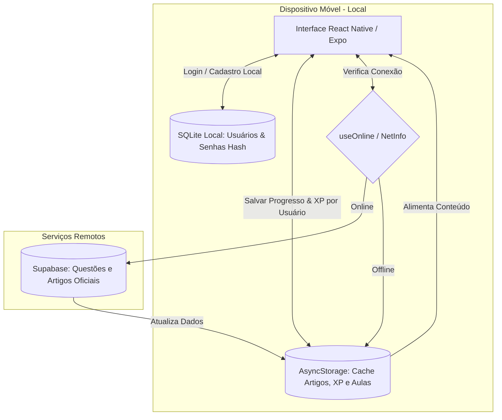

# 🏅 Olympic Hub (OLITEF)

<p align="center">
  
</p>

<p align="center">
  <b>Aplicativo Mobile de Educação Financeira e Preparatório Oficial para a OLITEF</b><br>
  <i>(Olimpíada do Tesouro Direto de Educação Financeira)</i>
</p>


## 📌 Sobre o Projeto

O **Olympic Hub** é um aplicativo mobile multiplataforma (Android e iOS) desenvolvido para democratizar o ensino de finanças entre estudantes do Ensino Fundamental e Médio. Ele combina **trilhas pedagógicas estruturadas**, **simulados cronometrados**, **artigos informativos** e **jogos lúdicos (gamificação)** para preparar os alunos para a OLITEF.

---

## ✨ Principais Funcionalidades

### 🔐 1. Autenticação e Segurança Local
* Cadastro e login de usuários gerenciados localmente no dispositivo via **SQLite (`expo-sqlite`)**.
* **Criptografia Forte:** Derivação de chaves de senha via **PBKDF2 com SHA-256** e salt criptográfico aleatório (`expo-crypto` + `@noble/hashes`), prevenindo vazamento de credenciais.
* Mensagens de erro unificadas contra enumeração de usuários por força bruta.

### 🗺️ 2. Trilhas de Aprendizagem Interativas
* Módulos educativos divididos por pilares: *Educação Financeira, Planejamento, Investimentos e Consumo Consciente*.
* Marcador de conclusão de aulas com persistência local e ganho de pontos de experiência (**+15 XP** por aula).
* Suporte completo para leitura offline com carregamento instantâneo a partir do cache.

### ⏱️ 3. Simulados Oficiais Cronometrados
* Banco de questões com enunciado e alternativas dinâmicas carregadas via nuvem (**Supabase**).
* Cronômetro de contagem regressiva contínuo e de baixo consumo de bateria.
* Feedback de desempenho detalhado ao final: total de acertos, erros, porcentagem de aproveitamento e premiação em XP.
* Proteção contra inicialização de simulados sem conexão com a internet.

### 📰 4. Artigos Educativos com Estratégia "Cache Primeiro"
* Artigos teóricos com formatação rica e títulos destacados em fonte **Quicksand**.
* Estratégia de rede resiliente com timeout de 8 segundos (`AbortController`) e fallback automático para cache local (`AsyncStorage`).

### 🎮 5. Joguinhos Educativos (CrossSums)
* Mini-jogo matemático e lógico integrado para fixação de raciocínio financeiro.
* Sistema de recompensas imediatas com adição de bônus de XP ao perfil do estudante.

### 👤 6. Perfil do Estudante & Gamificação Isolada (Multi-tenant)
* Painel com resumo de XP total acumulado, nível de experiência e quantidade de aulas concluídas.
* **Isolamento de Dados por Usuário:** Os dados de progresso e XP são atrelados dinamicamente ao ID do usuário conectado. Se um aluno sair e outro logar no mesmo aparelho, os dados não se misturam.

---

## 🏗️ Arquitetura e Fluxo Lógico

O aplicativo adota um modelo híbrido eficiente:



### Decisões Técnicas Importantes:
1. **Identidade Visual Centralizada (`src/theme/identidadeVisual.js`):** Padrão de design tokens para cores globais (`coresGlobais.fundoPadrao`) e tipografia de destaque (`Quicksand`), eliminando duplicações e estilos conflitantes.
2. **Suporte Nativo ao Botão Voltar (Android):** Mapeamento ultraleve em [App.js](file:///c:/Users/bonfa/OneDrive/Documentos/Projeto_Mobile/Projeto_Mobile/App.js) com `BackHandler`, com consumo zero de memória e desmontagem limpa de listeners.
3. **Automação de Dependências (`patch-package`):** Correções nativas em bibliotecas de terceiros (`metro` e `expo-asset`) salvas em `.patch`, garantindo que compilações em qualquer computador ou servidor CI/CD funcionem sem erros manuais.

---

## 🛠️ Tecnologias e Bibliotecas

| Categoria | Biblioteca / Recurso | Finalidade |
| :--- | :--- | :--- |
| **Core** | `React Native 0.88.1` & `Expo SDK 58` | Framework mobile multiplataforma |
| **Linguagem** | `JavaScript (ES6+)` | Desenvolvimento de lógica e componentes |
| **Nuvem / Backend** | `@supabase/supabase-js` | Banco de dados PostgreSQL na nuvem para questões e artigos |
| **Banco Local** | `expo-sqlite` | Armazenamento relacional seguro de usuários no aparelho |
| **Cache Local** | `@react-native-async-storage/async-storage` | Persistência de progresso (XP, simulados, aulas e cache) |
| **Conectividade** | `@react-native-community/netinfo` | Monitoramento de conectividade de rede em tempo real |
| **Criptografia** | `expo-crypto` & `@noble/hashes` | Hashing com salt e algoritmo PBKDF2 (SHA-256) |
| **Tipografia** | `@expo-google-fonts/quicksand` & `expo-font` | Tipografia padronizada para títulos e destaques visuais |
| **Ícones** | `lucide-react-native` & `@solar-icons/react-native` | Ícones vetoriais modernos |
| **Assets Vetoriais** | `react-native-svg` | Renderização de gráficos e ilustrações SVG |
| **Automação** | `patch-package` | Persistência determinística de correções em `node_modules` |
| **Build & Deploy** | `EAS Build (Expo Application Services)` | Compilação em nuvem de instaladores nativos (.apk / .ipa) |

---

## 📁 Estrutura do Projeto

```text
Projeto_Mobile/
├── assets/                    # Identidade visual, ícones e splash screen
├── patches/                   # Patches automáticos de dependências (patch-package)
├── src/
│   ├── components/            # Componentes reutilizáveis (Botões, Navbar, Banner Offline)
│   ├── database/              # Conexões e queries locais e remotas
│   │   ├── database.js        # Operações com SQLite local
│   │   ├── supabase.js        # Conexão com Supabase e Cache Primeiro
│   │   └── trilhasData.js     # Dados e metadados das trilhas
│   ├── hooks/                 # Hooks customizados
│   │   └── useOnline.js       # Monitor de status de conexão com a internet
│   ├── screens/               # Telas do aplicativo
│   │   ├── ArtigosScreen.js          # Lista de artigos com status de conexão
│   │   ├── CadastroScreen.js         # Criação de conta com hash de senha
│   │   ├── CrossSumsScreen.js        # Mini-jogo matemático de fixação
│   │   ├── DetalheEtapaScreen.js     # Módulos da etapa com cache offline
│   │   ├── ExecutarSimuladoScreen.js # Simulado com timer e pontuação
│   │   ├── HomeScreen.js             # Painel inicial e atalhos de estudo
│   │   ├── JoguinhosScreen.js        # Central de jogos educativos
│   │   ├── LerArtigoScreen.js        # Leitura formatada de artigo
│   │   ├── LerAulaScreen.js          # Leitura e conclusão de aula
│   │   ├── LoginScreen.js            # Login com autenticação SQLite
│   │   ├── PerfilScreen.js           # Visão de XP, aulas concluídas e logout
│   │   ├── SimuladosScreen.js        # Catálogo de simulados disponíveis
│   │   └── TrilhaScreen.js           # Lista das 4 trilhas pedagógicas
│   └── theme/
│       └── identidadeVisual.js       # Configuração global de cores e fontes
├── App.js                     # Componente raiz, orquestração e BackHandler
├── app.json                   # Configurações do Expo e identificadores nativos
├── eas.json                   # Perfis de build na nuvem (APK e Produção)
└── package.json               # Dependências e scripts de execução
```

---

## 🚀 Como Executar o Projeto Localmente

### Pré-requisitos
* [Node.js](https://nodejs.org/) (versão 18 ou superior)
* Aplicativo **Expo Go** instalado no celular ([Android](https://play.google.com/store/apps/details?id=host.exp.exponent) ou [iOS](https://apps.apple.com/app/expo-go/id982107779))

### 1. Clonar o repositório
```bash
git clone https://github.com/anafausta/Projeto_Mobile.git
cd Projeto_Mobile
```

### 2. Instalar as dependências
```bash
npm install
```
*(O script `postinstall` aplicará os patches necessários automaticamente via `patch-package`).*


### 3. Iniciar o servidor de desenvolvimento
```bash
npx expo start -c
```
Escaneie o QR Code exibido no terminal utilizando a câmera (iOS) ou o app Expo Go (Android).

---

